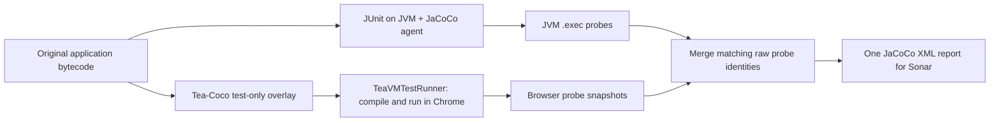

# Mockatcha + TeaVMTestRunner + Tea-Coco

A standalone Maven project using the existing Mockatcha **timesheet example**.
It combines ordinary Mockatcha mocks, mockatcha-bdd stubbing/call logs/matchers,
stock TeaVMTestRunner browser execution and Tea-Coco line/branch coverage.
No organisation parent or patched TeaVM runner is required by this project.

This example lives in [tea-coco/mockatcha-example](https://github.com/instanto-io/tea-coco/tree/main/mockatcha-example).
It consumes Mockatcha and mockatcha-bdd as external dependencies; it does not need
a dedicated example repository or a parent relationship with Tea-Coco.
Application classes are copied, with their Apache-2.0 notices, from
[Mockatcha's examples at 4357c2b](https://github.com/instanto-io/mockatcha/tree/4357c2b3a122ca12b6b2a15ff20267d11276ee62/mockatcha-examples).
The tests here add a deliberately complementary JVM/browser coverage exercise.

## Run

Use JDK 21, Maven and Chrome. With the snapshot dependencies already installed
locally, run:

```sh
mvn clean verify
python3 verify_coverage.py
```

For Instanto snapshot consumption, use the included `settings.xml`. Provide
`FORGEJO_PACKAGE_USER` and `FORGEJO_PACKAGE_TOKEN` through your environment or CI
secrets, then run `mvn -s settings.xml -U clean verify`. These resolve the existing
Mockatcha and Tea-Coco libraries; this project does not publish a library artifact.
The source libraries can also be built locally following their own setup guides.

## Read the example

1. `TimesheetService` asks the repository for a draft, submits it, and requests
   approval when hours exceed 40. Missing drafts fail before submission.
2. `TimesheetJvmTest` uses Mockatcha on the JVM to exercise the missing-draft path.
3. `TimesheetCoreBrowserIT` uses core `mock`, `when`, `verify` and argument matchers
   for ordinary and boundary-hour weeks, compiled by TeaVM into browser tests.
4. `TimesheetBddBrowserIT` uses mockatcha-bdd `spyOn`, `calls` and `stringContaining`
   for overtime and a concrete repository spy. Real storage behavior is retained
   while the draft lookup is overridden.
5. `verify_coverage.py` proves the raw JVM/browser union improves both line and
   branch coverage and that packaged application classes retain their original bytes.

The browser classes use `@SkipJVM` and `@After` cleanup. They deliberately avoid
`@Rule` so they work with stock TeaVMTestRunner, without Instanto's rule extension.
This does not prevent applications from using that extension where desired.
Each browser scenario runs in ordinary, optimized and minified JavaScript modes.
The mocks are test collaborators; Tea-Coco measures only `src/main/java` application
classes, not mock implementations or the testing libraries.

## How JaCoCo and Tea-Coco map to test runners

Maven's **Surefire and Failsafe** plugins select and launch tests. **JUnit 4 and
TeaVMTestRunner** decide where those tests execute. **JaCoCo and Tea-Coco** collect
coverage; neither replaces the test runner. Mockatcha and mockatcha-bdd supply the
mocks and assertions inside those tests, independently of coverage collection.

| Test selection in this POM | Maven launcher | JUnit runner and execution | Coverage mechanism |
| --- | --- | --- | --- |
| `**/*JvmTest.java` | Surefire, `test` phase | Ordinary JUnit 4, JVM | JaCoCo JVM agent records original application classes into `target/jacoco.exec` |
| `**/*BrowserIT.java` | Failsafe, `integration-test` phase | `@RunWith(TeaVMTestRunner.class)` compiles to JavaScript and runs in Chrome; `@SkipJVM` prevents the runner's JVM execution | Tea-Coco prepares JaCoCo-compatible probes in test-only class copies, collects browser hits, and reports against preserved originals |



The build order in [pom.xml](pom.xml) is deliberate:

1. JaCoCo `prepare-agent` populates `jvmCoverageArgs`. Only Surefire uses
   `<argLine>@{jvmCoverageArgs}</argLine>`, so the JVM test has the standard agent.
2. Maven compiles the application with line debug information, runs the JVM test,
   and packages its ordinary application JAR.
3. Tea-Coco `prepare`, bound to `pre-integration-test`, preserves those exact class
   bytes and creates `target/teavm-coverage/jacoco/classes`. This ordering prevents
   instrumented copies from entering the application JAR.
4. Failsafe uses that directory as `classesDirectory`. Its empty `argLine` keeps
   the JVM agent away from the already instrumented copies. The coverage-enabled
   TeaVM compilation loads Tea-Coco from the test classpath; no runner fork or
   custom `@RunWith` class is needed.
5. Stock TeaVMTestRunner runs the browser tests and captures output. Tea-Coco
   flushes probe snapshots when the stock test entry point completes or raises an
   error. Keep the Failsafe XML reports and their captured output: the reporter
   consumes them. Asynchronous test work must be awaited before the test ends.
6. At `verify`, JaCoCo writes its JVM-only report. Tea-Coco writes a browser-only
   report, then a merged report using `<executionData>` pointing at `jacoco.exec`.
   Failsafe's final `verify` still fails the build if any browser test failed.

Tea-Coco uses JaCoCo's original class IDs and probe indices for the union. A hit
from either runtime covers that probe; overlapping hits count once. The same
JaCoCo analyzer then calculates line and branch counters from the original class
files. It does not add XML percentages or infer a covered branch from a hit on the
same source line. Recompile and collect both sides together with `clean verify`;
raw data from changed class versions cannot safely be merged.

### Applying this layout to another library or application

- Keep application Java sources and compiled classes available, including line
  debug metadata. This example instruments its own `src/main/java` classes; the
  Mockatcha dependencies remain outside the measured application scope.
- Add `tea-coco` as a test dependency and `tea-coco-maven-plugin` for preparation
  and reporting. Retain `teavm-junit` and the other TeaVM test dependencies shown
  in this POM. Use compatible versions of the plugin and runtime.
- Separate JVM and browser test selection explicitly. The `JvmTest`/`BrowserIT`
  suffixes are this example's convention, not a Tea-Coco requirement. Existing
  Surefire-based browser suites can stay on Surefire if their preparation phase,
  classpath and agent configuration are arranged accordingly.
- Keep the normal agent on JVM tests and off the browser compilation's prepared
  classes. Preserve report output until after the merge.
- For a test-only project measuring a separately packaged library, select that
  artifact with `dependencyIncludes` and supply its `sourceRoots`, as explained in
  the [JaCoCo mode guide](../docs/jacoco-mode.md). Do not include mock libraries just
  because they are dependencies of the tests.
- Import the **single merged XML** for these sources into Sonar. Other modules can
  retain their own JaCoCo reports; avoid importing overlapping browser generic
  coverage or a second JVM-only XML for this same scope.

For a custom browser harness, automatic stock-runner flushing does not apply:
flush on successful and failed completion with the prepared run ID and preserve
captured probe output. See [custom harnesses](../docs/jacoco-mode.md#custom-harnesses-and-implementation-boundary).
This example demonstrates TeaVM's JavaScript backend with JUnit 4, not JUnit 5,
WebAssembly or arbitrary browser runners. Gradle integration is documented in the
[same guide](../docs/jacoco-mode.md#gradle); the Maven phase split here illustrates
responsibilities rather than imposing Maven on the coverage runtime.

## Expected result

| Runtime | Lines | Branch outcomes |
| --- | ---: | ---: |
| JVM | 7 / 29 | 1 / 6 |
| Browser | 27 / 29 | 5 / 6 |
| Merged | 28 / 29 | 6 / 6 |

The remaining missed application line is not hidden. The browser's five outcomes
and the JVM's one outcome are complementary, so identity-aware merging reaches
six. Importing two XML count summaries would not establish that union.

Surefire runs the JVM test against original classes with JaCoCo's JVM agent.
Tea-Coco then prepares an overlay in `pre-integration-test`; Failsafe runs browser
tests against it **without** the agent. The normal application JAR is already
packaged from originals. Reports are written before Failsafe's final failure check,
so available coverage is retained without changing a failing build into success.

| Output | Contents |
| --- | --- |
| `target/site/jacoco/index.html` | JVM-only JaCoCo HTML report |
| `target/browser-coverage.xml` | Browser-only standard JaCoCo XML |
| `target/teavm-coverage.xml` | Merged standard JaCoCo XML for Sonar |
| `target/teavm-coverage.xml.exec` | Matching raw merged probe data |
| `target/compiler-evidence.json` | Instrumented-build reachability diagnostics |
| `target/coverage-comparison.md` | Checked side-by-side totals |

For Sonar, import only `target/teavm-coverage.xml` with
`sonar.coverage.jacoco.xmlReportPaths` for these application sources. Keep any
quality-gate changes separate. JavaScript is the supported coverage backend here;
compiler diagnostics do not subtract omitted code from the denominator.

## CI

Tea-Coco CI runs this project after publishing its verified snapshots, using an
isolated Maven cache. The job uploads diagnostic reports to `packages.instanto.io`
and verifies their SHA-256 on readback. It uses the organisation Forgejo package-user
and package-write token secrets and the `instanto-container` runner. This example
does not deploy an application JAR and is not part of the default Maven reactor,
so the tool's normal build remains independent of Mockatcha snapshot availability.
